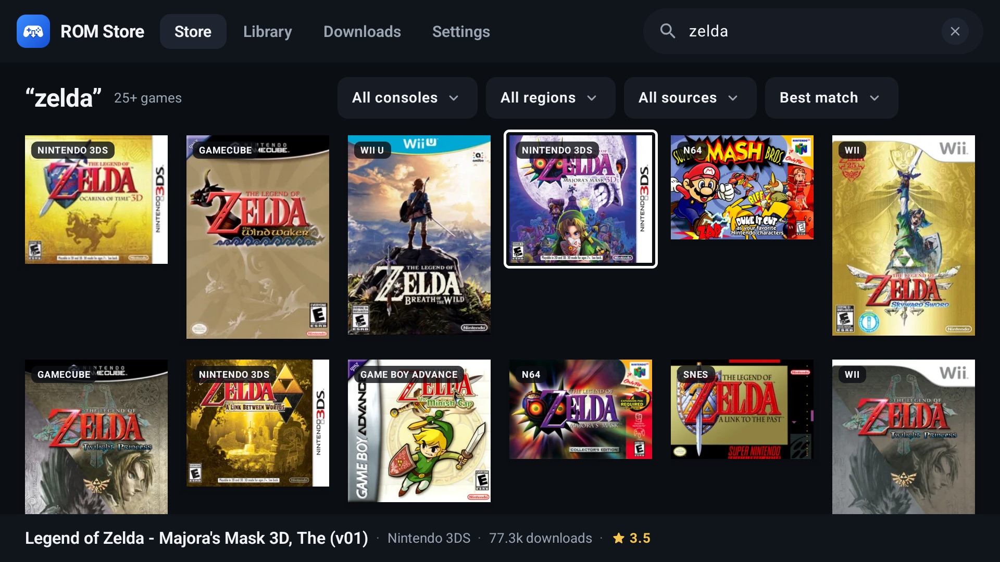
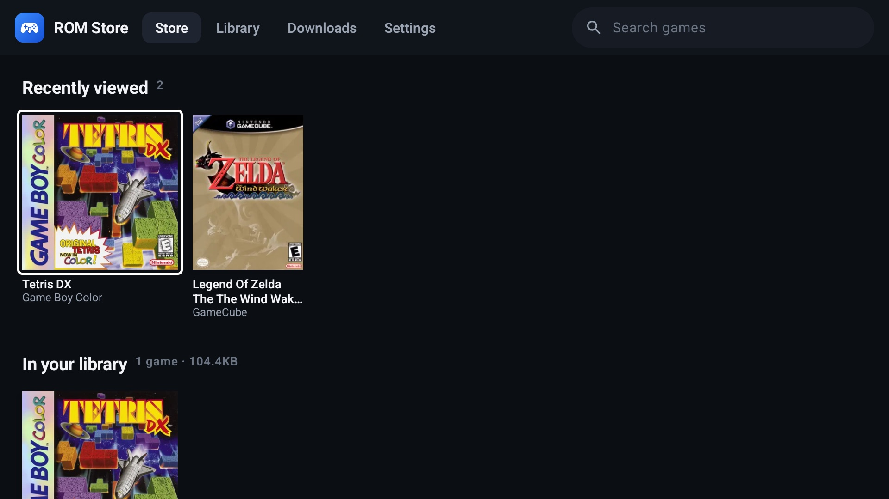
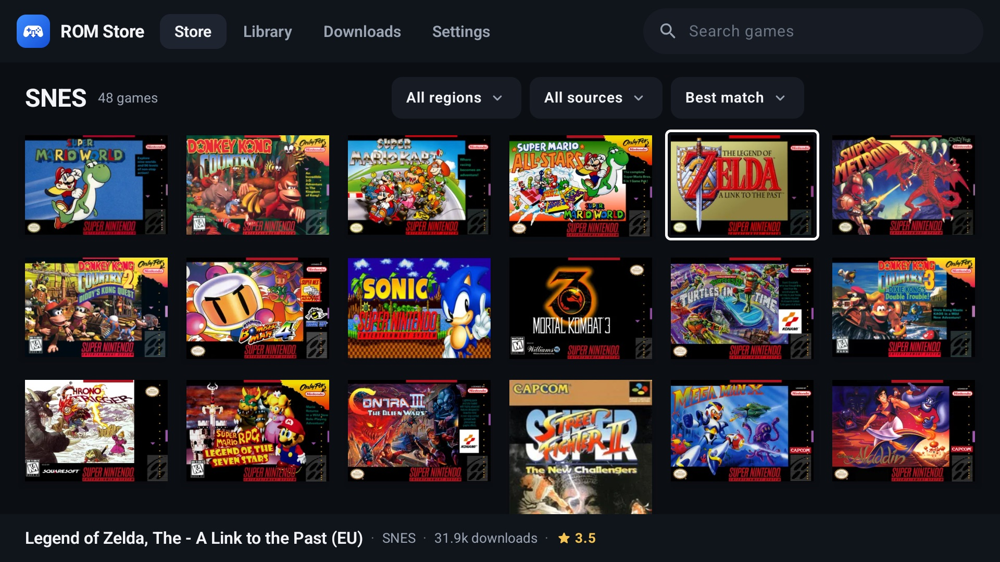
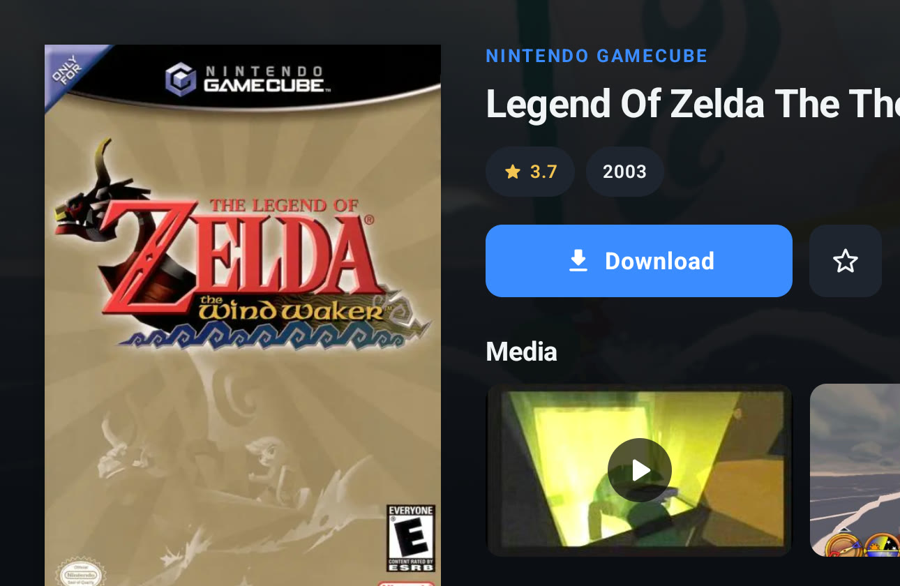
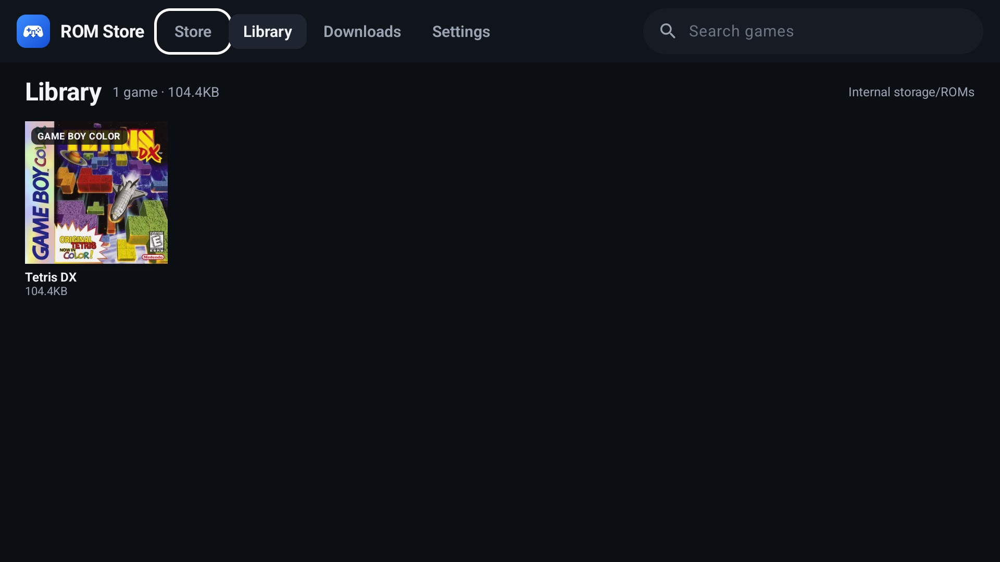

<p align="center">
  
</p>

<h1 align="center">ROM Store for Android</h1>

<p align="center">
  A store-style game browser for Android handhelds — search the catalogue sites you use, see every game with its real box art, and download it straight into your emulator folders.<br>
  Built for landscape and a controller (AYN Odin, Retroid Pocket, AYANEO Pocket and friends), and just as happy with a touch screen.
</p>

<p align="center">
  <a href="https://github.com/uposum/rom-store-android/releases/latest/download/ROM-Store.apk"><b>Download the APK</b></a> ·
  <a href="https://github.com/uposum/rom-store-android/releases">All releases</a>
</p>



| | |
|---|---|
|  |  |
|  |  |

## What it does

- **One search, every source.** Asks all the catalogue sites you set up at once, merges the duplicates and shows one cover per game, with the consoles, regions and versions it exists in.
- **Real box art in real shapes.** Front scans from libretro-thumbnails and GameTDB first, so a SNES box is landscape, a Game Boy box square and a Switch case tall. SteamGridDB and IGDB fill the gaps. Artwork is never cropped.
- **A proper game page.** Poster, rating, year, size, screenshots, the trailer, a description, and every version on every source — the one that will finish first on top (measured speeds, your preferred region).
- **Your folders.** Pick a ROM folder once; each console's games go into its own subfolder (`gba`, `snes`, `psx`, …) — the layout ES-DE, Daijishō and most emulators expect. Any console can have a folder of its own instead (an SD card, an existing collection).
- **Downloads that survive.** Run in the background with a notification, continue where they stopped after a restart, and are never saved when a link turns out to be a web page.
- **Unpacking where it is needed.** Disc games for emulators that cannot read a `.zip` or `.7z` (PlayStation, GameCube, Wii, PS2, Switch, …) are unpacked after the download. ZIP, 7z and RAR.
- **Library.** Everything in your console folders with covers and real names: open a game in your emulator, unpack it, look it up in the store, or delete it.
- **Shelves.** Recently viewed, favourites and your library on the home screen, then every console your sources can browse.
- **Made for handhelds.** Landscape first, full screen, every control reachable with the d-pad, one white focus ring, and the buttons do what they say at the bottom of the screen.

## Install

1. On your device, download [`ROM-Store.apk`](https://github.com/uposum/rom-store-android/releases/latest/download/ROM-Store.apk) and open it. Android asks once to allow installs from your browser or file manager.
2. Open ROM Store. The home screen asks for two things:
   - **Your ROM folder** — pick it with the system folder picker (create one, e.g. `ROMs`, if you have none). Android does not allow the root of a drive or the Download folder; any folder inside works.
   - **Your sources** — Settings → Sources. ROM Store ships with readers for several catalogue sites but **none of their addresses**: enter the address of each site you use. A source without an address is never contacted.
3. Search, or pick a console.

Updates install over the old version (same signing key) and keep your settings.

Requires Android 8.0 or newer.

## Controls

| Button | Does |
|---|---|
| D-pad / stick | Move between covers, tabs and controls |
| A | Open / press |
| B | Back one step (closes the game page, then the results, then the tab) |
| X | Search (on a game page: download) |
| Y | Favourite the game in focus |
| L1 / R1 | Previous / next tab (on a game page: previous / next game) |
| L2 / R2 | Scroll the results a page |
| Start | Downloads |
| Select | Clear finished downloads (Downloads tab) |

The hint bar at the bottom appears when a controller is connected. Everything also works by touch.

## Settings

- **ROM folders** — the ROM folder, and a folder per console if you keep some elsewhere.
- **Sources** — the address of each site, on/off, how well it has been working, its measured speed, and a speed test (reads a few seconds of one real file per source; weekly by itself if you like).
- **Downloads** — how many at once, unpacking (disc games / every archive / keep the archive), preferred region.
- **Artwork** — libretro box scans, small grid covers through wsrv.nl, IGDB ratings and media, IGDB covers over the sites' ones, your own SteamGridDB key.
- **Display** — titles under the covers.
- **Storage** — cached searches and game pages (kept 72 hours, one small file each).

## Not in the Android version

ROM Store started as a [Decky plugin for the Steam Deck](https://github.com/uposum/decky-rom-store). Everything tied to Steam is left out here: Steam shortcuts and collections, Steam ROM Manager, Steam library artwork. Mods (GameBanana → Ryujinx/yuzu/Dolphin) are left out too: on Android those emulators keep their data in app-private storage that other apps cannot write to. BIOS checks are left out because every Android emulator keeps its BIOS in a different place.

## What this app is — and is not

ROM Store is a client. The app and this repository contain **no games, no BIOS files, no keys and no site addresses**. It searches the sites you enter, shows what they publish, and on your explicit tap saves the file the site serves into your own folder. It does not host, mirror, bundle or seed anything, and it never works around logins, captchas, browser checks or download limits — those are reported. Whether a download is lawful depends on where you live and on the game; that is your responsibility.

## Building

Requirements: JDK 17 and the Android SDK (platform 36). Gradle comes with the wrapper.

```bash
./gradlew :core:test            # parsers against recorded pages, downloads, unpacking, library
./gradlew :app:assembleDebug    # app/build/outputs/apk/debug/app-debug.apk
./gradlew :app:assembleRelease  # signed with keystore.properties if present, else the debug key
```

The project has two modules:

- `core` — plain Kotlin/JVM: the site readers (`sources/`), merging and matching (`model/`), artwork lookups (`art/`), HTTP, downloads, unpacking, library scanning, settings and the store service (`store/`). Unit-tested on the JVM with recorded pages.
- `app` — the Android app: Jetpack Compose UI, the storage-access-framework library, the download service.

## Releases

Pushing a tag `vX.Y.Z` runs [`.github/workflows/release.yml`](.github/workflows/release.yml): tests, builds the release APK with version `X.Y.Z` (version code `X*10000+Y*100+Z`), checks its signature and version, and publishes `ROM-Store-vX.Y.Z.apk`, `ROM-Store.apk` and `SHA256SUMS.txt` on a GitHub release.

```bash
git tag -a v1.0.0 -m "ROM Store 1.0.0" && git push origin v1.0.0
```

Signing uses four repository secrets — without them the release is signed with a throwaway key and will not install over other builds:

| Secret | Value |
|---|---|
| `ROMSTORE_KEYSTORE_BASE64` | `base64 -i release.jks` |
| `ROMSTORE_STORE_PASSWORD` | keystore password |
| `ROMSTORE_KEY_ALIAS` | key alias |
| `ROMSTORE_KEY_PASSWORD` | key password |

Keep the keystore safe: a release signed with another key cannot update installed copies.

## License

MIT — see [LICENSE](LICENSE).
